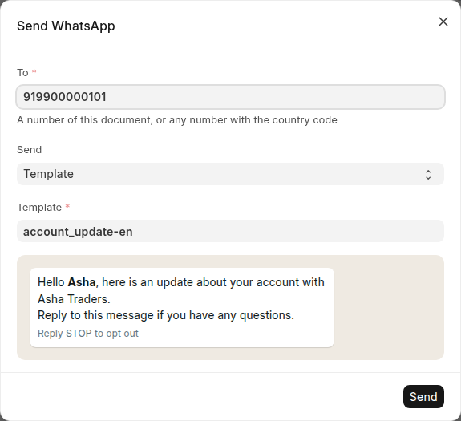
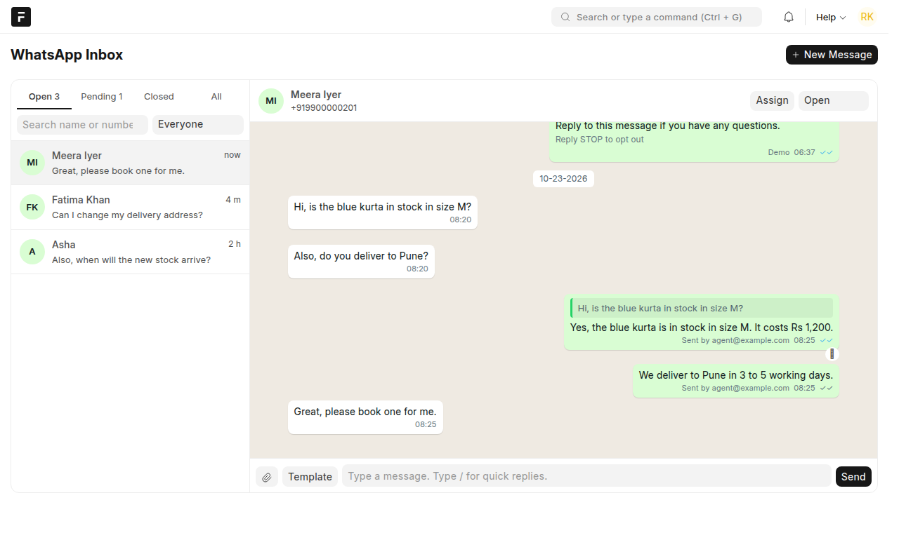
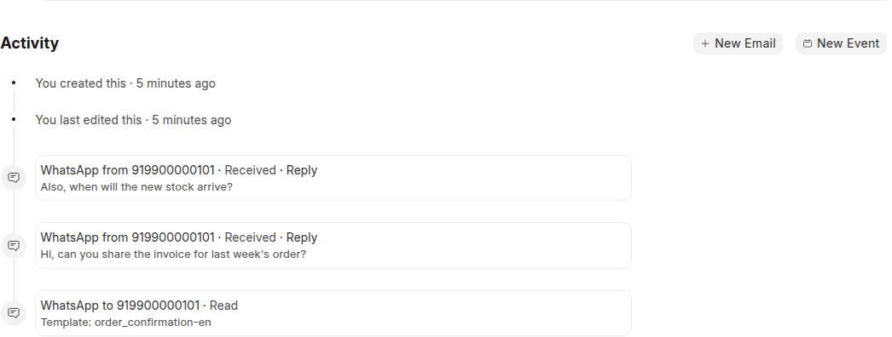
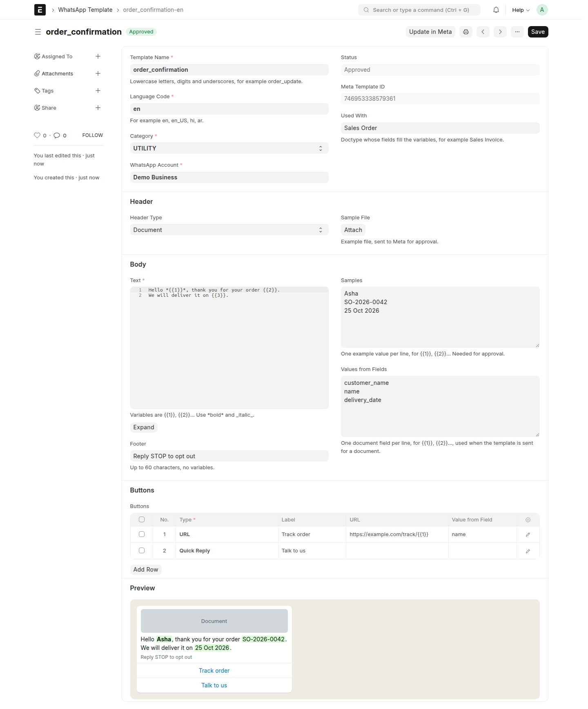
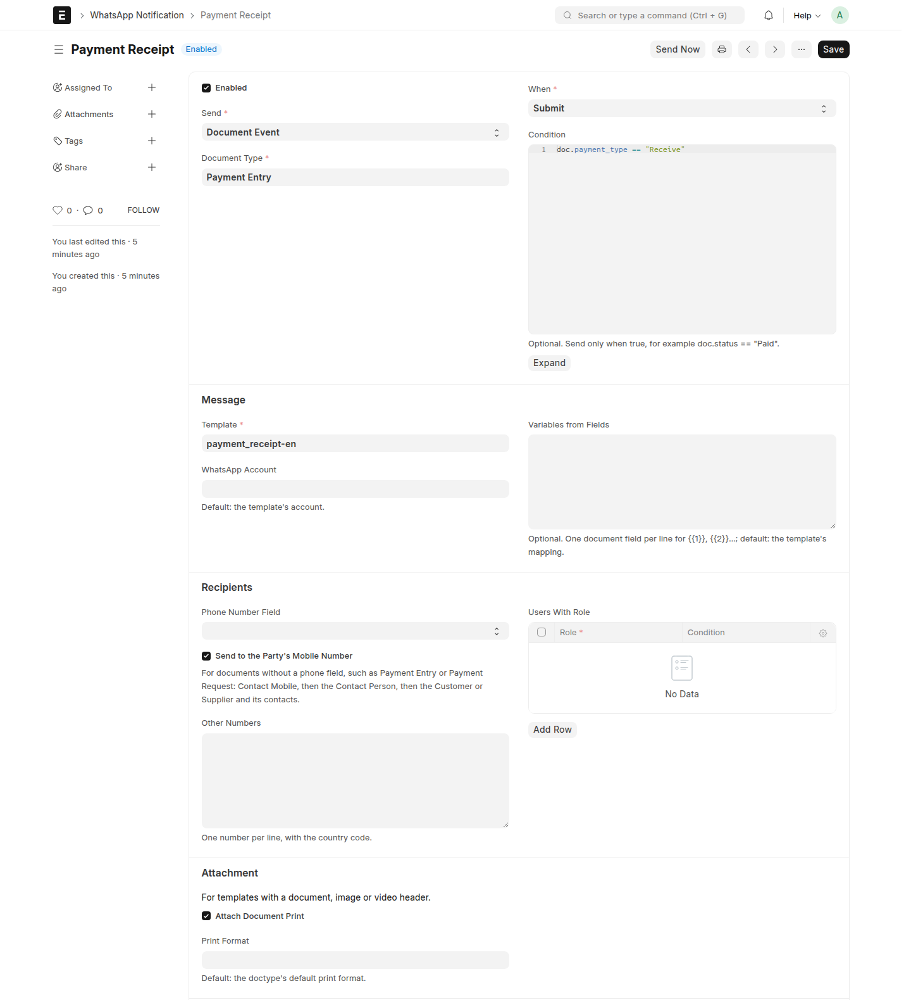
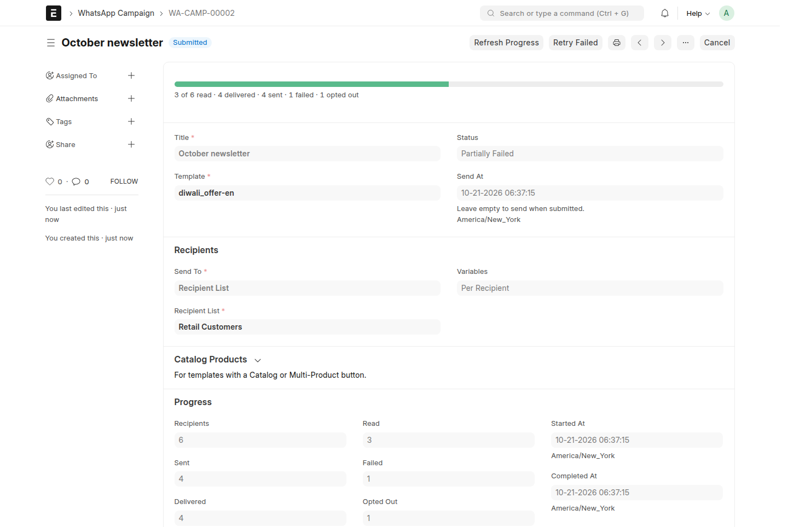
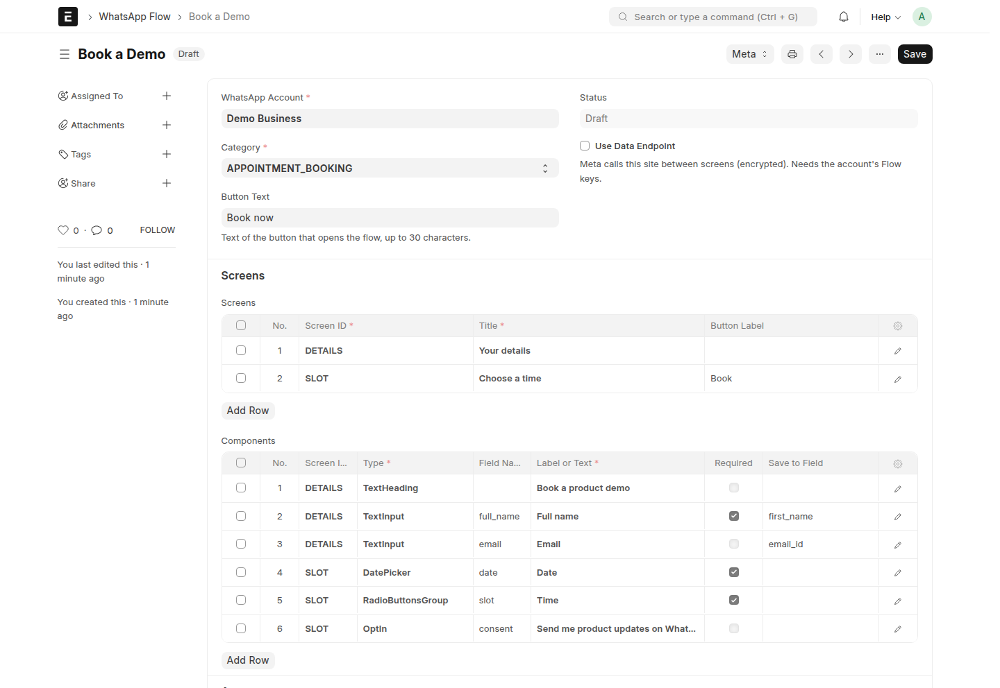
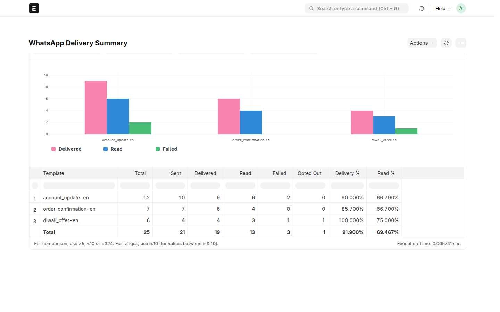

<!-- Copyright (c) 2026, 8848 Digital LLP and contributors. License: MIT. See license.txt -->

<p align="center"></p>

# WhatsApp Connect

## Overview

WhatsApp Connect lets Frappe and ERPNext send and receive WhatsApp messages
through the Meta WhatsApp Business Platform (Cloud API), with no third-party
gateway. Teams send templates from any document, automate notifications
(for example invoices and payment receipts), run campaigns, chat with
customers inside the document timeline, and collect structured answers with
WhatsApp Flows. It works on Frappe 14, 15 and 16, with or without ERPNext.

| | |
| --- | --- |
| **Frappe** | 14, 15, 16 |
| **License** | MIT |
| **Maintained by** | [8848 Digital LLP](https://8848digital.com) |

## Quick start

You need a Frappe or ERPNext site on Frappe 14, 15 or 16 that is reachable
from the internet over `https://`, and a phone number for WhatsApp Business
that can receive an SMS or a call.

**1. Install the app**

```bash
bench get-app https://github.com/8848digital/whatsapp_connect
bench --site <your-site> install-app whatsapp_connect
```

**2. Connect your number**

Open **WhatsApp Setup** (type it in the search bar) and click **Connect with
Facebook**. Log in, choose or create your business, add your number and type
the code that WhatsApp sends. The page does the rest: it registers the
number, connects webhooks and syncs your templates.


> Already have a Meta app? Click **Enter App Details** instead and enter the
> App ID, App Secret and a system user token. The page finds your numbers
> and sets the webhook for you.

**3. Test it**

Click **Test** next to your number. Send `hello_world` to your mobile, then
send a message from your phone and click **Check Incoming**.

**4. Start sending**

Open any document, for example a Customer or a Sales Invoice, and click
**⋯ > Send WhatsApp**. To send messages automatically, create a
**WhatsApp Notification** (see the [user guide](docs/user-guide.md)).

Something did not work? Each setup step shows the reason; see
[Troubleshooting](#troubleshooting).

## Key DocTypes

| DocType | Owned by this app? | Purpose |
| ------- | ------------------ | ------- |
| WhatsApp Account | Yes | A WhatsApp Business phone number connected through a Meta app. The WhatsApp Setup page creates it. |
| WhatsApp Settings | Yes | App-wide settings: webhook signature policy, default country code, log retention, phone source for users. |
| WhatsApp Message | Yes | Every message sent or received, with its delivery status and Meta's error. |
| WhatsApp Profile | Yes | One customer number: WhatsApp name, linked Contact, opt-out state, last message time, and its conversation in the WhatsApp Inbox (status, assignee, unread count). |
| WhatsApp Quick Reply | Yes | A saved answer that agents insert in the WhatsApp Inbox. |
| WhatsApp Auto Reply | Yes | A rule that answers incoming messages: keyword, button, welcome, away or fallback. |
| WhatsApp Auto Reply Settings | Yes | Business hours and a switch that pauses all auto-replies. |
| WhatsApp Template | Yes | Message templates approved by Meta, with variables filled from document fields. |
| WhatsApp Notification | Yes | Sends a template automatically on a document event, a date or a schedule. |
| WhatsApp Recipient List | Yes | A reusable list of numbers with per-recipient values. |
| WhatsApp Campaign | Yes | Sends a template to many recipients, now or later, with progress and retries. |
| WhatsApp Flow | Yes | Screens of forms that customers fill inside WhatsApp. |
| WhatsApp Flow Response | Yes | The answers of one customer to a flow. |
| WhatsApp Log | Yes | Graph API calls and webhook calls, for troubleshooting. |
| WhatsApp Hub Settings, WhatsApp Hub Connection | Yes | Only on the 8848 hub site, which runs Connect with Facebook for all sites. |

## Features

- **Setup from ERPNext.** The WhatsApp Setup page connects a number with
  Facebook login (or your own Meta app), sets up webhooks, syncs templates
  and tests sending and receiving. No Meta App Dashboard work.
- **Send from any document.** **⋯ > Send WhatsApp** on every form offers the
  document's and its contacts' numbers, sends an approved template with a
  preview filled from the document, or a free-text reply within 24 hours of
  the customer's last message.

  

- **WhatsApp Inbox.** Agents chat with customers from one screen, as in
  WhatsApp Web. Conversations update in real time and show unread counts.
  Assign a conversation, set it to Open, Pending or Closed, reply with
  text, a file, a quick reply or a template, and see when the 24-hour
  reply window closes. **New Message** starts a chat with any number.
  Agents get a popup, a browser notification and a desk notification for
  new messages; a click opens the chat.

  

- **Auto-replies.** Answer keywords and button taps, send a welcome message
  and an away message outside business hours, and reply with ERP data such
  as order status or the outstanding balance. Rules stop when an agent takes
  the conversation.

- **Conversations in the timeline.** Messages appear in the timeline of their
  document; incoming messages are linked to the Contact, Lead or Customer
  with the same number. Customers, suppliers and leads also show their
  contacts' chats. **Reply** opens the dialog. Optionally, a message from an
  unknown number creates a Lead (ERPNext or Frappe CRM), so no enquiry is lost.

  

- **Templates** with a live WhatsApp preview: header (text, image,
  document, video), variables, footer and buttons (quick reply, call, URL,
  copy code, one-time password, flow, catalog, multi-product). Submit to
  Meta, sync from Meta, status updates from the webhook.

  

- **Notifications** on document events (new, save, submit, cancel, delete,
  value change), dates (days before/after) and schedules. Send to a phone
  field, the party's mobile number (Payment Entry, Payment Request), other
  numbers or users with a role. Attach the document print as a PDF.

  

- **Campaigns** to recipient lists (imported from any doctype), with values
  for everyone or per recipient, at a set time. Rate limits are retried,
  failed messages can be sent again, and progress is shown.

  

- **WhatsApp Flows**: build screens and fields, publish in Meta, send them,
  and save the answers as a document (for example a Lead). Flows with a data
  endpoint are supported, with Meta's encryption.

  

- **Delivery report** by template, campaign, account or day, and **failure
  reasons** from Meta on each failed message.

  

- **Opt-out**: customers who send STOP get no more templates or campaigns;
  START opts them in again.
- **Security**: webhook and Flow endpoint calls must be signed with the Meta
  App Secret.
- **Media**: files are uploaded to Meta, so private files and sites that Meta
  cannot reach work; incoming media is saved as private files.
- **Coexistence**: messages typed in the WhatsApp Business app on the phone
  are saved too.

The complete list is in [docs/features.md](docs/features.md), and the step-by-step
guide in [docs/user-guide.md](docs/user-guide.md).

## Integrations

- **Meta WhatsApp Business Platform (Cloud API)**: connected by the WhatsApp Setup page; details in [SETUP.md](./SETUP.md#whatsapp-setup-page)
- **Meta webhooks**: set by the setup page; manual values in [SETUP.md](./SETUP.md#webhooks)
- **WhatsApp Flows data endpoint** (optional): see [SETUP.md](./SETUP.md#whatsapp-flows-data-endpoint-optional)
- **WhatsApp hub** (8848 Digital): see [docs/hub-setup.md](docs/hub-setup.md)

## Installation

```bash
bench get-app https://github.com/8848digital/whatsapp_connect
bench --site <site_name> install-app whatsapp_connect
```

Then open **WhatsApp Setup** (see [Quick start](#quick-start)). On Frappe
Cloud, install the app from the Marketplace and open the same page.

## Troubleshooting

| Problem | What to do |
| ------- | ---------- |
| **Connect with Facebook** is greyed out | Set **Hub URL** in WhatsApp Settings, or use **Enter App Details**. |
| A setup step shows **Failed** | Read its message, fix the cause, and click **Run Setup Again**. |
| "Meta can only call a site on the internet over https://" | The site must have a public HTTPS address. Set `host_name` in the site config. |
| **Check Incoming** finds nothing | Open **WhatsApp Log**: no webhook call means Meta cannot reach the site. |
| The test message is refused | The number may need to be registered, or the recipient number is wrong. Open the message in **WhatsApp Message** for Meta's reason. |
| More | [SUPPORT.md](SUPPORT.md) |

## App Structure

See [CLAUDE.md](./CLAUDE.md) for the module and folder conventions, and
[docs/development.md](docs/development.md) for the development setup.

## Maintainers

8848 Digital LLP — [open an issue](https://github.com/8848digital/whatsapp_connect/issues/new/choose).
See [SUPPORT.md](SUPPORT.md) and [SECURITY.md](SECURITY.md).

## License

MIT. Copyright (c) 2026 8848 Digital LLP. See [license.txt](license.txt).
