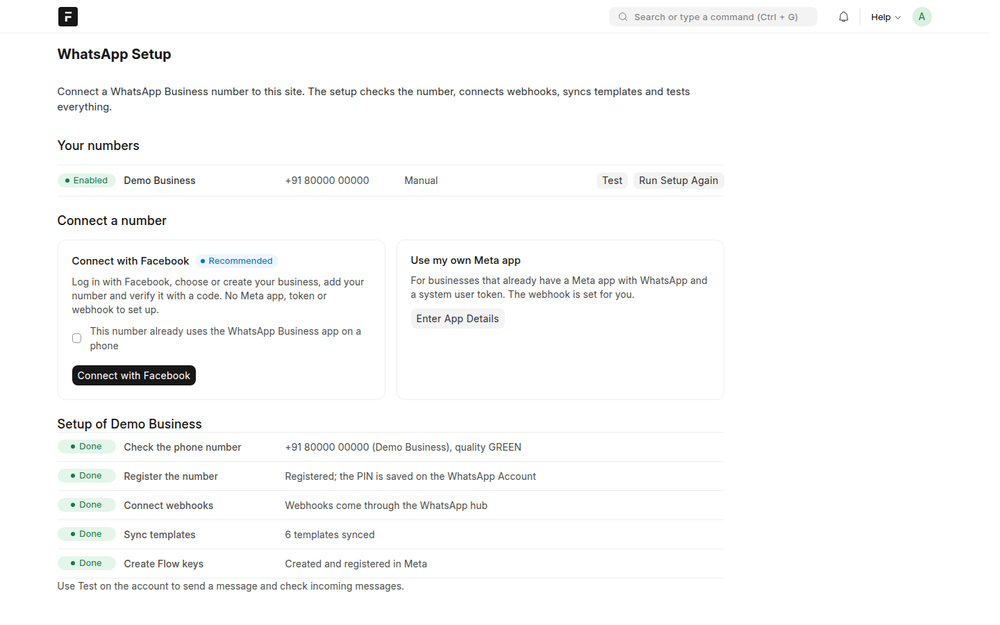
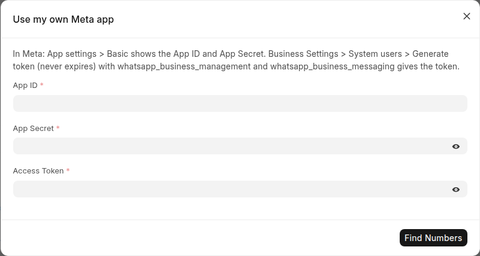
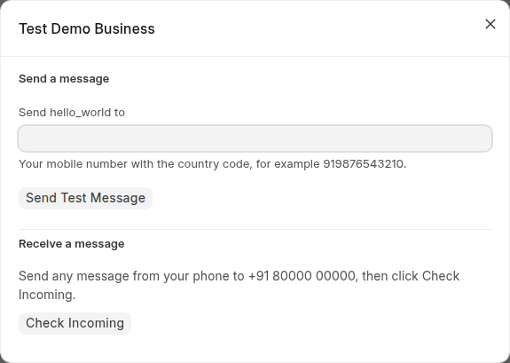

<!-- Copyright (c) 2026, 8848 Digital LLP and contributors. License: MIT. See license.txt -->

# SETUP.md

## WhatsApp Setup page

### Overview

Open **WhatsApp Setup** (search bar, or the button on the WhatsApp Account
list). The page connects a number, sets up webhooks, syncs templates and
tests the connection. There are two ways to connect:

| | Connect with Facebook | Use my own Meta app |
| --- | --- | --- |
| For | Most businesses | Businesses that already have a Meta app |
| You need | A Facebook login and a phone number that can get an SMS or a call | App ID, App Secret and a system user token |
| Work in Meta | Only the Meta login window | Create the app and the token once |
| Webhooks | Through the 8848 hub, nothing to set | Set by the page through the Graph API |
| Needs | **Hub URL** in WhatsApp Settings | The site on a public HTTPS address |

### Option 1: Connect with Facebook (recommended)

1. In **WhatsApp Settings**, check that **Hub URL** is set (your provider gives it).
2. Open **WhatsApp Setup** and click **Connect with Facebook**.
   - If the number is already in the WhatsApp Business app on a phone and
     you want to keep using the app, select **This number already uses the
     WhatsApp Business app** first.
3. In the Facebook window: log in, choose or create your business, add your
   number and type the code that WhatsApp sends to it.
4. The window closes and the page sets up the number. Each step shows
   **Done** or **Failed** with the reason.

The site gets a token that does not expire. You do not create a Meta app,
a token or a webhook.

### Option 2: Use my own Meta app

You need, from Meta:

| Item | Where in Meta |
| ---- | ------------- |
| App ID, App Secret | App Dashboard > App settings > Basic |
| Access token | Business Settings > Users > System users > **Generate token**: choose the app, **Never** expires, permissions `whatsapp_business_management` and `whatsapp_business_messaging`. Assign the WhatsApp account to the system user first. |

1. Open **WhatsApp Setup** and click **Enter App Details**.
2. Enter the App ID, App Secret and token, and click **Find Numbers**.
3. Choose the number. Select **Register the number** only for a new number
   that has never sent messages through the Cloud API.
4. Click **Connect**. The page saves the WhatsApp Account, points the app's
   webhook to this site and runs the setup steps.

The site must be reachable from the internet over `https://`, because Meta
checks the webhook URL while the page sets it.

### Setup steps

| Step | What it does |
| ---- | ------------ |
| Check the phone number | Reads the number from Meta with the token; saves the display number. |
| Register the number | Registers the number for the Cloud API with a new 6-digit PIN, saved (encrypted) on the account. Skipped for numbers that stay on the WhatsApp Business app. |
| Connect webhooks | Embedded Signup: subscribes the app to the business account. Own app: sets the app webhook (callback URL, verify token, fields) and subscribes the app. |
| Sync templates | Copies the templates of the business account. |
| Create Flow keys | Creates the key pair for WhatsApp Flows and registers the public key. |

**Run Setup Again** on a number repeats the steps, for example after you
fix a problem in Meta.

### How to Test

Click **Test** on the number:

1. **Send Test Message** sends the `hello_world` template to your mobile
   number. New business accounts have this template.
2. Send any message from your phone to the business number and click
   **Check Incoming**. The page shows the message when the webhook works.

If a step fails, the message tells you what to do. **WhatsApp Log** has
every call to Meta and every webhook call.

### Settings DocType Fields

**WhatsApp Settings**:

| Field | Type | Mandatory | Notes |
| ----- | ---- | --------- | ----- |
| Hub URL | Data | For Connect with Facebook | The hub site, for example `https://hub.example.com`. |
| Refuse Unsigned Webhook Calls | Check | No | Refuses webhook calls when no account has an App Secret. |
| Default Country Code | Data | No | Added to numbers stored without one, for example `91`. |
| Keep WhatsApp Logs for (Days) | Int | No | Default 30; 0 keeps them. |
| Phone Number of Users | Select | No | Where role-based notifications find users' numbers (User or Employee). |
| Create a Lead for Unknown Numbers | Check | No | Creates a Lead when a number that matches no Contact, Lead or Customer writes. |
| Lead Type | Select | No | Lead (ERPNext) or CRM Lead (needs Frappe CRM). |
| Lead Source | Data | No | Default WhatsApp. Created when it does not exist. |
| Lead Owner | Link (User) | No | Owner of new Leads. Their WhatsApp Inbox conversation is assigned to this user. |
| Notify Agents of New Messages | Select | No | Who gets a popup and a desk notification for a new message: the assigned user, else all agents (default); the assigned user only; or nobody. Agents are users with the WhatsApp Manager or WhatsApp User role. |

**WhatsApp Auto Reply Settings** (optional, for away messages):

| Field | Type | Mandatory | Notes |
| ----- | ---- | --------- | ----- |
| Pause All Auto-Replies | Check | No | Stops all WhatsApp Auto Reply rules. |
| Business Hours | Table | For away messages | Day, opens at, closes at; system time zone. A day without a row is closed. With no rows, away messages are never sent. |

**WhatsApp Account** (one per number; the setup page fills it):

| Field | Notes |
| ----- | ----- |
| Setup Method | Manual or Embedded Signup. |
| Default for Outgoing / Incoming Messages | One default per direction. The first connected number becomes the default. |
| Send Read Receipts | Marks incoming messages as read in WhatsApp. |
| Phone Number ID, WhatsApp Business Account ID, App ID | From Meta. |
| Access Token, App Secret | Encrypted. For Embedded Signup, the App Secret is the hub's forwarding secret for this site. |
| Webhook Verify Token | Created by the setup. |
| Two-Step Verification PIN | Created when the setup registers the number. |
| Graph API URL / Version | `https://graph.facebook.com`, for example `v24.0`. |

### Site Config / Environment Variables

None. All configuration is stored in the DocTypes above. Meta must reach the
site's public URL; set `host_name` in the site config when the site is
behind a proxy.

## Meta WhatsApp Cloud API (manual setup)

Use this only when the setup page cannot be used. Create the WhatsApp
Account yourself with the values from the Meta App Dashboard: **WhatsApp >
API Setup** (phone number ID, business account ID) and **App settings >
Basic** (App ID, App Secret), and a system user token. Then click
**Subscribe App to Webhooks** and set the webhook in Meta as below.

## Webhooks

The setup page sets the webhook. To set it by hand in the Meta App
Dashboard, **WhatsApp > Configuration > Webhook**:

| Meta setting | Value |
| ------------ | ----- |
| Callback URL | `https://<site>/api/method/whatsapp_connect.whatsapp_connect_core.api.v1.webhook.receive` |
| Verify token | The account's Webhook Verify Token |
| Webhook fields | `messages`, `message_template_status_update`; `smb_message_echoes` if the number is also used in the WhatsApp Business app |

With an App Secret, unsigned or forged calls get HTTP 403.

**How to test:** send a message from your phone to the business number. It
appears in **WhatsApp Message** and in the timeline of the Contact with
that number.

## WhatsApp Flows Data Endpoint (optional)

Only for flows with **Use Data Endpoint**. Meta encrypts these calls with
the account's public key, which the setup creates (**Create Flow keys**).

| Item | Where |
| ---- | ----- |
| Flow key pair | Created by the setup, or WhatsApp Account → **Generate Flow Keys** |
| Endpoint URL | Set when the flow is saved to Meta: this site's endpoint, or the hub's for Embedded Signup accounts (WhatsApp Account → Flow Endpoint URL) |

**How to test:** open the flow's preview link (Meta > **Open Preview**) and
go through the screens.

## Payment links (optional)

`payment_link` and `payment_link_token` in a template mapping need ERPNext and
a **Payment Gateway Account** (for example with the payments app and
Razorpay or Stripe). WhatsApp Connect makes the Payment Request with ERPNext
and does not send its email. The Pay now button uses the page
`/whatsapp_pay` on your site, which must be reachable on the internet.

## Frappe CRM (optional)

Frappe CRM works on Frappe 15 and 16. WhatsApp Connect serves the WhatsApp tab
of CRM Leads and CRM Deals.

1. Install Frappe CRM on the site: `bench get-app crm`, then
   `bench --site <site> install-app crm`.
2. Run `bench --site <site> migrate`. This gives Sales User and Sales Manager
   read access to the template list.
3. Give the CRM users the Sales User or Sales Manager role. They can then use
   WhatsApp in CRM for the leads and deals they can open.
4. Set a default outgoing WhatsApp Account. CRM shows the WhatsApp tab only
   when one is enabled.

The tab shows all messages of the record's numbers (its phone fields, its
contacts, and the lead of a deal). Free text needs a customer message in the
last 24 hours; after that, send a template. Make and change templates in
**WhatsApp Template**, not with **Create New Template** in CRM.

Do not install the frappe_whatsapp app on the same site: it uses the same
doctype names.

## WhatsApp Hub (8848 Digital only)

The hub is the site that runs Connect with Facebook for all customer
sites. It is set up once by 8848 Digital: see
[docs/hub-setup.md](docs/hub-setup.md).
