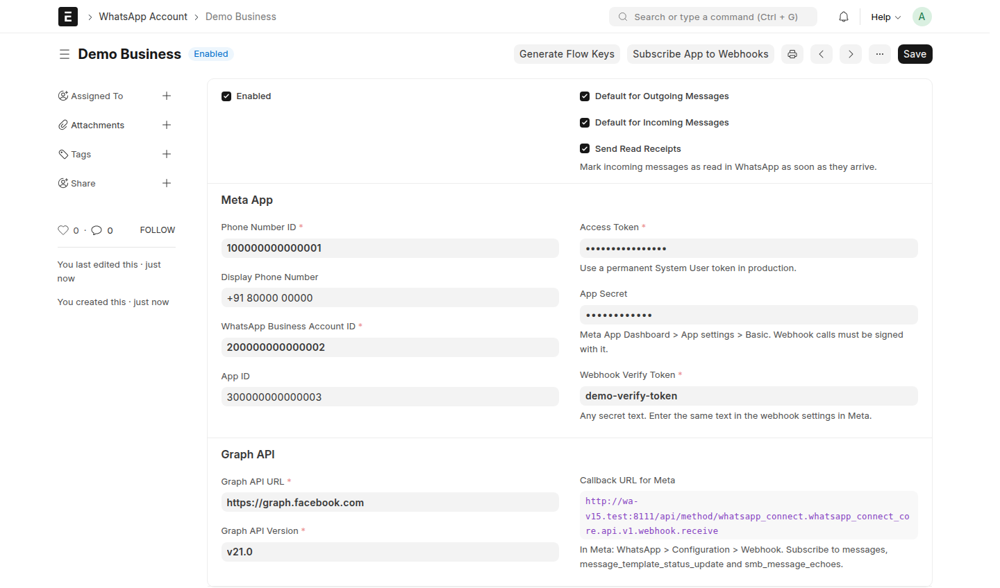

<!-- Copyright (c) 2026, 8848 Digital LLP and contributors. License: MIT. See license.txt -->

# User guide

This guide shows how to use WhatsApp Connect, step by step. To connect the
app to Meta first, see [SETUP.md](../SETUP.md).

## 1. Connect a WhatsApp account

1. Go to **WhatsApp Account** and click **Add WhatsApp Account**.
2. Enter the values from the Meta App Dashboard (see SETUP.md), the App
   Secret, and a Webhook Verify Token of your choice.
3. Select **Default for Outgoing Messages** and **Default for Incoming
   Messages** if this is your main number.
4. Save, then click **Subscribe App to Webhooks**.
5. Copy the **Callback URL for Meta** shown on the form into the webhook
   settings in Meta.

## 2. Add templates

To start a conversation, WhatsApp requires a template that Meta approved.
Free text is allowed only within 24 hours of the customer's last message.

- **To get your existing templates:** go to **WhatsApp Template** and click
  **Sync from Meta**.
- **To make a new template:**
  1. Click **Add WhatsApp Template**. Enter a name (lowercase letters, digits,
     underscores), the language code and the category.
  2. Write the text with variables `{{1}}`, `{{2}}`... and give one sample
     per line in **Samples**.
  3. Optional: set **Used With** (for example Sales Order) and, in **Values
     from Fields**, one field per line for `{{1}}`, `{{2}}`...
  4. Optional: add a header, a footer and buttons. The **Preview** shows
     the message as WhatsApp shows it.
  5. Save and click **Submit to Meta**. The status changes to **Approved**
     when Meta approves it.

## 3. Send from a document

Open a document (for example a Contact, Customer or Sales Invoice) and click
**⋯ > Send WhatsApp**.

1. In **To**, select a number of the document or its contacts, or type one
   with the country code.
2. Select **Template**, pick a template, check the preview, and click **Send**.

To answer a customer who wrote in the last 24 hours, select **Free-text
reply**, or click **Reply** on their message in the timeline.

## 4. Follow the conversation

Messages appear in the timeline of the document they belong to. Incoming
messages are linked to the Contact, Lead or Customer with the same number,
whatever the number format. A Customer, Supplier or Lead also shows the
messages of its contacts.

## 5. Send messages automatically

Go to **WhatsApp Notification** and click **Add WhatsApp Notification**.

1. **Send**: Document Event, Date Based, or Scheduled.
   - Document Event: pick the **Document Type** and **When** (New, Save,
     Submit, Cancel, Delete, Value Change, Save After Submit).
   - Date Based: pick a date field and the days after it (negative for
     days before).
   - Scheduled: pick the frequency and, optionally, document filters.
2. Optional: a **Condition**, for example `doc.status == "Paid"`.
3. Pick the **Template**.
4. **Recipients**: a phone field, **Send to the Party's Mobile Number** (for
   Payment Entry, Payment Request and other documents without a phone
   field), other numbers, or users with a role.
5. Optional: **Attach Document Print** (sent as a PDF, in the print format
   you pick), an attachment field, or a fixed file.
6. Save. Click **Send Now** to test it with one document.

**Example — payment receipt:** Document Type *Payment Entry*, When *Submit*,
condition `doc.payment_type == "Receive"`, a template with the fields
`party_name`, `paid_amount`, `name`, Send to the Party's Mobile Number, and
Attach Document Print.

**Example — payment link:** Document Type *Payment Request*, When *Submit*,
a template with a URL button ending in `{{1}}`, and `payment_url` in the
button's **Value from Field**.

## 6. Send a campaign

1. Optional: go to **WhatsApp Recipient List**, add numbers, or set the
   import settings (document type, phone field, name field, variable fields,
   filters) and click **Import Recipients**.
2. Go to **WhatsApp Campaign** and click **Add WhatsApp Campaign**.
3. Pick the template, the recipient list or numbers, and the values:
   **Same for Everyone** or **Per Recipient**.
4. Optional: a header file, catalog products, and **Send At**.
5. Submit. Without Send At, sending starts at once.

The campaign shows its progress. Click **Refresh Progress** for the latest
delivery counts, and **Retry Failed** to send failed messages again.

## 7. Build a WhatsApp Flow

1. Go to **WhatsApp Flow** and click **Add WhatsApp Flow**.
2. Add **Screens** (an ID such as `DETAILS`, and a title).
3. Add **Components**: for each, the screen ID, the type, a field name for
   answers, the label, and whether it is required.
4. Optional: in **Save Answers To**, pick a doctype (for example Lead), and set
   **Save to Field** on the components.
5. Save, then **Meta > Save to Meta**. Fix any validation errors that Meta
   reports, then **Open Preview** to try it.
6. **Meta > Publish** when it is ready (a published flow cannot be changed),
   and **Send to a Number**.

The answers are saved in **WhatsApp Flow Response**.

## 8. Check delivery

- **WhatsApp Delivery Summary** (report): sent, delivered, read, failed and
  opted-out messages with rates, by template, campaign, account or day.
- A failed message shows Meta's **Error Code** and **Error Message**; click
  **Send Again** to retry it.

## 9. Opt-out

When a customer sends **STOP**, their **WhatsApp Profile** is marked **Opted
Out**: templates, notifications and campaigns are not sent to them, while
free-text replies are still allowed. **START** removes the opt-out.

